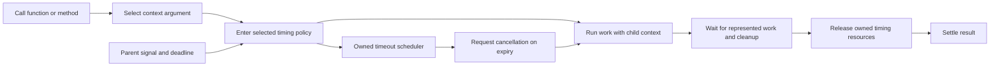
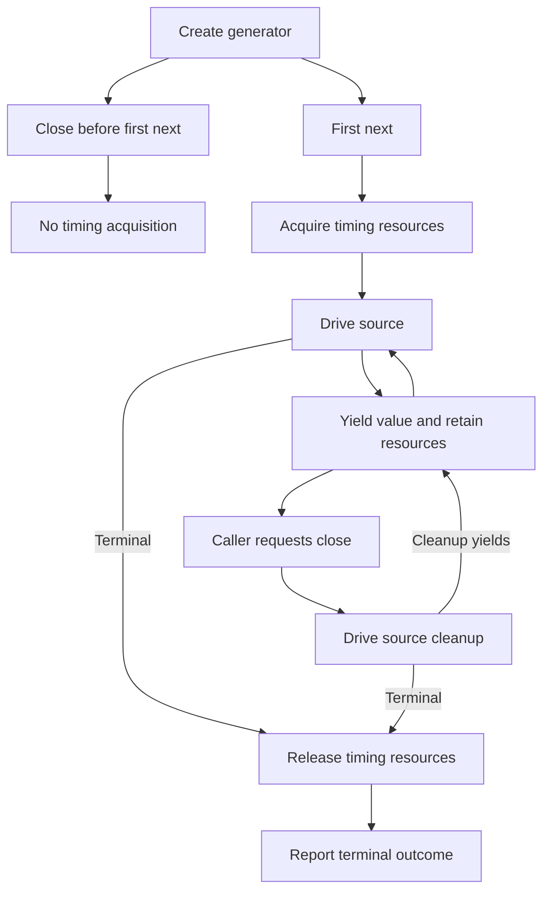

# ADR-0004: Timing authoring facades and iterator ownership

## Status

Proposed for review. The requirements below are targets, not claims of current
implementation or evidence. Acceptance, implementation, verification, and
release authority are separate.

## Context

### Background and Problem Statement

Contexts supplies generic asynchronous function and standard method adapters;
this provider owns timing and cancellation policy. The current timer candidate
can adapt a supplied scope, but it does not offer named timing or combined
timing/cancellation conveniences. Timer scope construction is asynchronous at
its resource boundary and cannot, by itself, preserve a synchronous result or
the lifetime of a caller-driven iterator.

Historical contexts provided
[timed functions](https://github.com/MatrixAI/js-contexts/blob/9af3ce279308469f54edfed4ceca0ed06c0829df/src/functions/timed.ts),
[timed methods](https://github.com/MatrixAI/js-contexts/blob/9af3ce279308469f54edfed4ceca0ed06c0829df/src/decorators/timed.ts),
and combined
[functions](https://github.com/MatrixAI/js-contexts/blob/9af3ce279308469f54edfed4ceca0ed06c0829df/src/functions/timedCancellable.ts)
and
[methods](https://github.com/MatrixAI/js-contexts/blob/9af3ce279308469f54edfed4ceca0ed06c0829df/src/decorators/timedCancellable.ts).
The timed forms covered synchronous results, promises, generators, and async
generators. They used owned and borrowed timers differently; when both a timer
and signal were inherited, they assumed those inputs were already connected. The
combined form was promise-oriented and could settle eagerly. Its method settings
could depend on the receiver. These observations motivate migration; they do not
prove that every old behavior remains desirable or safe.

The historical contexts manifest selected timer version 2. A review of
[timer version 2.1.1](https://github.com/MatrixAI/js-timer/blob/fe492358d4aba1b3fc352713fd1b5f79c446100d/src/Timer.ts)
shows that a timer was a cancellable thenable with reset and refresh, an
infinite delay option, and eager or lazy handling of cancellation while its
handler ran. The current timer separates cancellation requests from actual
handler completion. Version 2.1.1 is a reviewed compatible release, not a claim
about the historical lockfile's exact resolution. The
[version 4 entrypoint](https://github.com/MatrixAI/js-timer/blob/bacfcb2cdf3d18de0316cfdffc924ec7f0be97b3/src/index.ts)
exposed timer and scope mechanisms but no named timing decorators.

Contexts ADR-0007 covers asynchronous adapters with explicitly selected context
positions. Its generator ownership decision, ADR-0013, covers a specific
caller-driven async-generator source contract and does not provide a synchronous
generator. The timer decisions
[ADR-0002](../0002-timer-execution-and-completion/adr.md) and
[ADR-0003](../0003-scoped-deadlines-and-timing/adr.md) retain timer completion,
scope ownership, deadline clocks, and cancellation direction.

### A time budget around an order read

An order service calls a remote system. The caller wants a bounded time budget,
the read needs a signal to observe expiry, and the service must keep its timing
resources until the read and its cleanup finish. A parent request may already
have an earlier deadline; starting a child must not silently extend it. A
timeout is a cancellation request, not proof that the remote read stopped.



For compatible fixed deadlines, the effective bound is the earlier parent or
child bound. A relative duration starts when the selected scope enters. A
resettable timer is not automatically such a fixed constraint. The selected
policy must say what it provides and whether an existing timer is borrowed.

### Timed functions and standard methods

The following TypeScript-like examples illustrate the intended authoring style.
An unreleased working-tree candidate exists but full conformance is not yet
established. The caller passes the required context, the adapter selects the
second argument, and the provider supplies the child timing context. Separate
function and decorator entrypoints let both forms use the concise name `timed`.

```typescript
import { timed } from '@matrixai/timer/functions';

type RequestContext = { traceId: string; signal: AbortSignal };

async function readOrder(
  orderId: string,
  context: RequestContext,
): Promise<string> {
  return await readFromServer(orderId, context.signal);
}

const readTimed = timed(readOrder, {
  context: 1,
  kind: 'async',
  duration: 1_000,
});
const parent = new AbortController();
const order = await readTimed('order-1', {
  traceId: 'trace-1',
  signal: parent.signal,
});
```

An illustrative method decorator uses the same policy and selected argument:

```typescript
import { timed } from '@matrixai/timer/decorators';

class OrderService {
  readonly prefix = 'orders';

  @timed({ context: 1, kind: 'async', duration: 1_000 })
  async read(orderId: string, context: RequestContext): Promise<string> {
    return `${this.prefix}:${await readOrder(orderId, context)}`;
  }
}

const service = new OrderService();
const parent = new AbortController();
const order = await service.read('order-1', {
  traceId: 'trace-1',
  signal: parent.signal,
});
```

If expiry occurs, the child signal is aborted. The read may reject with that
reason, handle the request and return, or keep working. The asynchronous facade
must retain the represented work and mandatory cleanup in each case. The result
is not implicitly an early-rejecting timeout race.

The snippets are separate examples. A module using both forms can alias one
import, while keeping the decorator name short. The candidate exposes these
entrypoints but has not been released. The later timing-function examples reuse
the function form shown above.

### Synchronous work is still synchronous

A caller may instead need an ordinary synchronous value:

```typescript
function formatOrder(orderId: string, context: RequestContext): string {
  context.signal.throwIfAborted();
  return `order:${orderId}`;
}

const formatTimed = timed(formatOrder, {
  context: 1,
  kind: 'sync',
  duration: 1_000,
});
const parent = new AbortController();
const label = formatTimed('order-1', {
  traceId: 'trace-1',
  signal: parent.signal,
}); // A string, not a promise.
```

This form cannot synchronously join an independently running asynchronous
handler or asynchronous cleanup. Such an ownership combination must be rejected
rather than hidden behind the returned string. A host timer also cannot
interrupt uninterrupted synchronous JavaScript while it holds the event loop.

### Caller-driven generators keep the budget alive

A generator can be constructed before the caller requests its first item. The
budget should not start merely because the generator object was returned, and
the provider must not release timing resources after a single yield while the
caller can still resume it.



For a synchronous generator, both iteration and the applicable provider release
remain synchronous:

```typescript
function* orderRows(query: string, context: RequestContext): Generator<string> {
  for (const row of availableRows(query)) {
    context.signal.throwIfAborted();
    yield row;
  }
}

const timedRows = timed(orderRows, {
  context: 1,
  kind: 'generator',
  duration: 1_000,
});
const parent = new AbortController();
const rows = timedRows('open orders', {
  traceId: 'trace-1',
  signal: parent.signal,
}); // No timing acquisition yet.

try {
  const first = rows.next(); // Acquires on first advancement.
  if (!first.done) useRow(first.value);
} finally {
  rows.return(undefined); // This source has no yielding cleanup.
}
```

An async generator keeps its async protocol and awaits release on terminal
completion or close:

```typescript
async function* orderUpdates(
  orderId: string,
  context: RequestContext,
): AsyncGenerator<string> {
  for await (const update of updatesFromServer(orderId, context.signal)) {
    context.signal.throwIfAborted();
    yield update;
  }
}

const timedUpdates = timed(orderUpdates, {
  context: 1,
  kind: 'async-generator',
  duration: 1_000,
});
const parent = new AbortController();
for await (const update of timedUpdates('order-1', {
  traceId: 'trace-1',
  signal: parent.signal,
})) {
  useRow(update);
  if (enoughUpdates(update)) break; // Requests iterator close.
}
```

These examples use cooperative sources. If authored cleanup yields a further
value, one close request may not finish it: the caller must continue driving the
protocol according to the documented policy. Dropping a suspended generator does
not automatically close it. The contexts owning async generator is a possible
narrow mechanism for the async form, not a synchronous implementation or
evidence of timer integration.

### Timing plus caller cancellation

Some callers need both a time budget and a direct cancellation request. The
combined asynchronous facade is illustrated below; exact names, options, and the
method's static return shape remain subject to API review.

```typescript
import { timedCancellable } from '@matrixai/timer/functions';

const readTimedCancellable = timedCancellable(readOrder, {
  context: 1,
  duration: 1_000,
});
const parent = new AbortController();
const result = readTimedCancellable('order-1', {
  traceId: 'trace-1',
  signal: parent.signal,
});

result.cancel(new Error('caller no longer needs the order'));
await result; // Completion-safe default, not merely an abandoned wait.
```

The matching proposed method form can keep the same concise name:

```typescript
import { timedCancellable } from '@matrixai/timer/decorators';

class OrderService {
  @timedCancellable({ context: 1, duration: 1_000 })
  async read(orderId: string, context: RequestContext): Promise<string> {
    return await readOrder(orderId, context);
  }
}
```

The timer and cancellation links have one documented composition order. A
request through the result must not cancel the parent. If an early result is
offered separately, an owner must still be able to observe actual completion and
later failure.

### Historical use and migration boundary

The historical
[function tests](https://github.com/MatrixAI/js-contexts/blob/9af3ce279308469f54edfed4ceca0ed06c0829df/tests/functions/timed.test.ts)
showed `timed(f, 50)` applied to synchronous, promise, generator, and async
generator work. Those tests also demonstrated that plain timing signalled expiry
without automatically rejecting a promise. The old function accepted omitted
contexts and numeric or borrowed timer inputs in several cases. The examples in
this record use explicit context positions and distinguish the selected
protocol; they do not claim that the old call syntax or all inherited-timer
behavior is preserved.

## Decision Drivers

### Primary Decision Drivers

- Restore named timing authoring for all four requested operation forms.
- Retain ownership until the relevant represented work and cleanup complete.

### Secondary Decision Drivers

- Preserve standard decorator and function parity without legacy metadata.
- Separate fixed deadlines, resettable timers, cancellation, and early waiting.
- Preserve iterator protocols without pretending abandonment is cleanup.

## Considered Options

### Option 1: Expose only the generic asynchronous scope adapter

**Advantages:** Reuses the existing contexts adapter directly.

**Disadvantages:** Omits named conveniences and synchronous or lazy forms.

**Risk Assessment:** Fails the requested authoring and protocol coverage.

### Option 2: Restore the historical wrappers unchanged

**Advantages:** Familiar names and broad historical function categories.

**Disadvantages:** Relies on legacy decorators and old promise and timer
settlement behavior; assumes inherited timer and signal linkage.

**Risk Assessment:** Can misstate ownership and completion under new providers.

### Option 3: Specify protocol-specific facades over shared timing policy

**Advantages:** Keeps authoring convenient while making result shape and
ownership explicit for each supported protocol.

**Disadvantages:** Synchronous ownership needs a synchronous release boundary;
it cannot automatically reuse an asynchronous scope.

**Risk Assessment:** Bounded by explicit supported combinations and dedicated
runtime, type, iterator, and installed-consumer evidence.

## Decision

Choose option 3. The provider supplies named timed functions and standard method
decorators for synchronous, asynchronous, generator, and async-generator work.
It also supplies an asynchronous combined timing/cancellation function and
method facade. Names, overloads, and configuration syntax are proposed API
review items; names must allow function and decorator imports without ambiguity.
The combined form does not by itself promise cancellable synchronous or iterator
results.

If accepted, REQ-TIMER-AUTHORING-001 below supersedes
[REQ-TIMER-FACADE-001](../0003-scoped-deadlines-and-timing/adr.md#REQ-TIMER-FACADE-001)
at the requirement level only. ADR-0003 remains authoritative for its other
requirements. Until acceptance, the older requirement remains active. The new
clause retains direct scope delegation for promise-returning work while allowing
protocol-appropriate synchronous ownership for the additional forms. It does not
change the contexts asynchronous adapter contract.

<a id="REQ-TIMER-AUTHORING-001"></a>

### REQ-TIMER-AUTHORING-001 - Named forms and shared policy

Requirement status: target. Level: MUST. Verification: runtime and type cases.
Evidence status: unevidenced.

The provider MUST expose named timed function and standard method forms for
plain synchronous results, promise-returning work, synchronous generators, and
async generators. Each supported form MUST have equivalent function and method
semantics for its selected timing policy, arguments, receiver, failures, and
owned lifetime. Promise-returning forms MUST delegate to the selected timing
scope semantics. Synchronous and iterator forms MUST implement the same
documented timing policy through protocol-appropriate ownership, rather than
pretending an asynchronous scope preserves a synchronous protocol. Decorators
MUST NOT require parameter decorators or reflection metadata.

The selection of function kind MUST be explicit in the API contract and MUST NOT
be inferred solely from constructor names. A supported decorator MUST preserve
its method's declared return protocol and MUST NOT claim that standard
decoration changes its static call signature. The public API MUST document its
supported function kinds, settings, and return shapes.

<a id="REQ-TIMER-AUTHORING-002"></a>

### REQ-TIMER-AUTHORING-002 - Context selection and settings

Requirement status: target. Level: MUST. Verification: runtime and type cases.
Evidence status: unevidenced.

Each form MUST explicitly select a required context argument by zero-based
position or `last`, reject invalid configuration and missing selected arguments
before entering work, preserve compatible unrelated fields, and avoid claiming
refined capabilities it does not supply. The function and method forms MUST
support per-invocation timing configuration, including receiver-dependent method
settings, evaluated at their documented entry boundary. Scope construction and
decorator application MUST NOT begin an invocation's budget. Supported context,
tuple, generic, and overload limits MUST be documented. An omitted legacy
context argument MUST NOT be presumed supported by these adapters.

<a id="REQ-TIMER-AUTHORING-003"></a>

### REQ-TIMER-AUTHORING-003 - Scheduling, signals, and borrowing

Requirement status: target. Level: MUST. Verification: timing ownership cases.
Evidence status: unevidenced.

Each invocation MUST document which timer, deadline, and signal capabilities it
provides, owns, or borrows. Expiry MUST request cancellation using its
documented reason; a request MUST NOT be described as body completion. A
supplied upstream signal propagates directionally, retaining the first reason
and never conferring authority over the parent. Pre-aborted and already-expired
entry MUST supply an already-aborted signal to the body rather than silently
widening the budget. Compatible inherited fixed deadlines MUST retain the
earlier bound; incompatible clock identities MUST be rejected under ADR-0003. A
borrowed timer MUST NOT be cancelled, reset, refreshed, or released on behalf of
its owner. A timer and signal supplied together MUST NOT be assumed connected
without an explicit contract. A resettable timer MUST NOT be treated as a fixed
deadline merely because it has a scheduled time.

The API MUST document unbounded timing, finite-duration validation, clock units,
timeout reason, and whether a timing capability is a timer object or only a
deadline and signal. It MUST NOT imply that the old numeric timer input, custom
timeout error, or default infinity is automatically preserved.

<a id="REQ-TIMER-AUTHORING-004"></a>

### REQ-TIMER-AUTHORING-004 - Synchronous result and release boundary

Requirement status: target. Level: MUST. Verification: synchronous cases.
Evidence status: unevidenced.

A synchronous timed call MUST return its synchronous value or throw its
synchronous failure without wrapping either in a promise. Its supported timing
owner MUST acquire and release all of its mandatory resources synchronously. It
MUST reject unsupported configurations before body entry if they require waiting
for independently asynchronous owned handler work or cleanup. It MUST NOT detach
such work and claim the call completed safely. Any separate asynchronous timing
scope retains the completion requirements of ADR-0003. The documentation MUST
state that a normal event-loop timer cannot preempt uninterrupted synchronous
JavaScript execution or guarantee a wall-clock bound.

<a id="REQ-TIMER-AUTHORING-005"></a>

### REQ-TIMER-AUTHORING-005 - Caller-driven generator lifetime

Requirement status: target. Level: MUST. Verification: iterator protocol cases.
Evidence status: unevidenced.

The synchronous generator facade MUST return a synchronous generator protocol;
the async-generator facade MUST return an async generator protocol. Neither MUST
convert the other protocol silently. Each MUST acquire on first `next`, and a
pre-start `return` or `throw` MUST NOT acquire or start a budget. Each MUST
forward supported `next`, `return`, and `throw` inputs and yielded and terminal
values, while retaining its owned timing resources until terminal source
completion or failure and required source and provider cleanup. A nonterminal
result from cleanup, including a yield inside `finally`, MUST retain ownership.
No background iteration or automatic close of an abandoned iterator is implied.

The synchronous generator path MUST use only synchronously releasable owned
resources and MUST reject incompatible ownership before source entry. The
async-generator path MUST await represented source and provider cleanup and MAY
use the contexts owning generator only within that adapter's documented source
and overlap contract. If async protocol calls overlap, the selected policy MUST
be documented and tested; a rejected overlap MUST NOT be represented as terminal
completion. Explicit disposal and close behavior MUST describe what happens when
source cleanup yields again. Abandonment or nonterminating cleanup can retain
ownership indefinitely.

<a id="REQ-TIMER-AUTHORING-006"></a>

### REQ-TIMER-AUTHORING-006 - Combined timing and cancellation

Requirement status: target. Level: MUST. Verification: combined provider cases.
Evidence status: unevidenced.

The combined promise-returning function and standard method forms MUST provide
the selected timing policy and invocation-local cancellation request authority
without cancelling borrowed parent resources. Their documented default result
MUST represent body completion and mandatory cleanup; expiry or a cancellation
request alone MUST NOT release it. If an early caller-facing result is offered,
its separately accessible owner-observable completion MUST retain represented
work and later failures. The function's cancellable return and the method's
static return-type limits MUST be documented and tested. The provider MUST state
scope ordering and ensure one authoritative timing/cancellation lifecycle for
the composed operation rather than introducing an untracked competing owner.

<a id="REQ-TIMER-AUTHORING-007"></a>

### REQ-TIMER-AUTHORING-007 - Failure roles and completion

Requirement status: target. Level: MUST. Verification: failure and gated cases.
Evidence status: unevidenced.

Acquisition failure MUST unwind acquired resources. Body, iterator, timer,
monitor, and mandatory cleanup failures MUST retain their identity and roles
under the documented combined-failure policy. Equal values MUST NOT by
themselves erase independent occurrences. An asynchronous facade MUST retain
actual represented completion after a request, including an independently
running owned handler. A synchronous facade MUST NOT claim ownership of an
asynchronous handler it cannot join. Detached body effects are not represented
unless explicitly included in the chosen contract.

### Required cases

Provider cases MUST cover function and standard method forms for every supported
protocol, selection and receiver-dependent settings, argument preservation,
invalid selection, supported and rejected types, and installed declarations. Use
controlled clocks and gates for fresh budgets, inherited bounds, expired and
pre-aborted entry, exact reasons, owned and borrowed resources, independent
overlapping invocations, body and cleanup failures, and completion after
requests. Check synchronous return and throw identity and incompatible async
ownership.

Generator cases MUST cover no acquisition before first advancement, pre-start
close and throw, every protocol channel, normal exhaustion, early close, yielded
cleanup, source and release failures, cancellation while suspended, abandonment
limits, and the documented overlap and disposal policies. Combined facade cases
MUST compare both forms, confirm local request authority and parent isolation,
and gate represented completion. Planned cases do not constitute evidence.

## Consequences

### Positive

- Provider-specific authoring covers ordinary calls and caller-driven iteration.
- Timing ownership and cancellation remain explicit for every protocol.

### Negative

- A synchronous protocol cannot transparently join asynchronous owned cleanup.
- A suspended abandoned generator may retain its timer and links indefinitely.
- Historical source and return compatibility must be assessed case by case.

### Neutral

- Contexts remains the coordination foundation, not the timing policy owner.
- Named facades do not replace the standalone timer or generic scopes.

## Decision Outcome

Named facades and protocol-specific ownership are proposed. An unreleased
candidate needs further review; the decision and evidence statuses remain
separate from the presence of code or successful tests.

## Related Decisions

- [Timer execution and completion](../0002-timer-execution-and-completion/adr.md).
- [Scoped deadlines and timing](../0003-scoped-deadlines-and-timing/adr.md).

## Links

- [Current asynchronous facades](../../src/facades.ts).
- [Timer scope](../../src/context.ts).
- [Deadline and timeout scopes](../../src/deadline.ts).

## More Information

The contexts owning async generator has a narrow source contract and rejects
overlapping operations. It is an available mechanism, not evidence that timer
integration or the synchronous generator protocol is already implemented.

## Audit

### 2026-11-11

**Status:** Pending

**Findings:**

| Finding                                | Files                                   | Lines          | Assessment                                                   |
| -------------------------------------- | --------------------------------------- | -------------- | ------------------------------------------------------------ |
| Named timing facade is absent          | [Public entrypoint](../../src/index.ts) | Root exports   | Existing factory is not a named policy facade                |
| Sync and iterator contracts are absent | [Facade source](../../src/facades.ts)   | Scope adapters | Async scope delegation does not establish protocol ownership |

**Summary:** Historical contexts and timer source were inspected. The proposed
requirements have no provider-specific implementation or execution evidence.

**Action Required:** Review protocol and public API choices, validate this
record, and add provider-specific implementation and evidence after acceptance.

### 2026-11-11

**Status:** Pending

**Findings:** The unreleased working tree has named function and decorator
subpaths for asynchronous, synchronous, and iterator timing, plus asynchronous
timing with local cancellation. Runtime, type, and packed-consumer cases cover a
subset of the proposed behavior. Inline generator expressions with explicitly
typed input values have an inference limitation; use a separately declared
generator function. The remaining protocol, setup, and cross-provider cases have
not been fully reviewed.

**Summary:** Candidate code and partial tests do not establish conformance or
change this record's proposed status.

**Action Required:** Complete the ownership, failure, package, and downstream
review before assigning requirement evidence or considering release.
