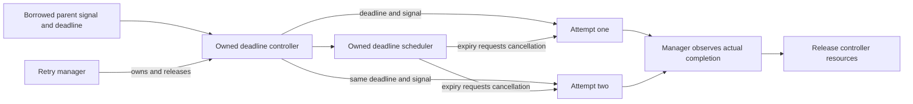

# ADR-0005: Independently owned deadline controller

## Status

Accepted. The active requirements define the independent deadline controller's
public contract. Acceptance does not assert implementation conformance, complete
evidence, or release authority; those are separate assessments.

## Context

### Background and Problem Statement

The timer provider already has a public timer object, fixed-deadline operations,
and deadline and timeout scopes. A scope controls the lifetime of its resources
around its represented body. That body may be asynchronous and may itself run
several operations; a scope is not limited to a synchronous lexical block.

A session, connection, service, retry manager, or caller-driven iterator may
instead need to start operations independently while sharing one deadline. Its
deadline enforcement has a lifetime belonging to that longer-lived object, not
necessarily to any one operation. Recreating a relative timeout for each retry
can extend the total budget. A scope can wrap a larger represented body, but
requiring an artificial pending body to retain the mechanism may not fit the
consumer's ownership boundary.

The cancellation provider's
[controller decision](https://github.com/MatrixAI/js-async-cancellable/blob/3bf93589b3ba4879181b93c8b5e8dc51e768bedc/specs/0005-cancellation-controller/adr.md)
selects a public cancellation controller with independently owned upstream
links. Its signal is observation, not authority; closing links neither aborts
the controller nor completes work. The same independence is a reason to
investigate a deadline controller, not proof that its public contract should
copy every cancellation-controller operation.

Contexts provides structural cancellation and deadline capabilities and generic
ownership helpers. Its
[cancellation and time decision](https://github.com/MatrixAI/js-contexts/blob/v4.0.0/specs/0004-cancellation-and-time-constraints/adr.md)
distinguishes signals, fixed absolute constraints, scheduling, and completion.
Contexts does not require a timer implementation, controller class, or automatic
resource ownership. Timer's accepted
[execution decision](../0002-timer-execution-and-completion/adr.md) and
[deadline decision](../0003-scoped-deadlines-and-timing/adr.md) remain binding;
this record does not supersede them.

### One total budget across independent attempts

A retry manager creates one enforcement mechanism when a request begins. Each
attempt receives the same fixed deadline and an observation signal. The manager
starts attempts when its retry policy allows and tracks the represented work and
required cleanup itself. Expiry requests cancellation; it does not finish an
attempt. Only after every represented use that depends on the mechanism has
finished can the manager release its scheduler and links.



This diagram does not imply automatic child tracking, propagation into detached
work, or release when any one attempt finishes. A manager can choose sequential
or concurrent attempts; it must observe the represented completion and cleanup
that its own release policy depends on.

The following TypeScript-like example uses the controller API. The
release helper is illustrative application code. `bracketResource` is the
existing contexts bracket. The attempt functions and parent context belong to
the application. The release helper below preserves distinct monitoring and
close failures rather than losing either one.

```typescript
import { bracketResource } from '@matrixai/contexts';
import { DeadlineController } from '@matrixai/timer';

async function closeAndObserveMonitoring(controller: DeadlineController) {
  let closeFailed = false;
  let closeFailure: unknown;
  try {
    controller.close();
  } catch (reason) {
    closeFailed = true;
    closeFailure = reason;
  }
  const monitoring = await controller.monitoring;
  if (monitoring.status === 'rejected') {
    if (closeFailed) throw new SuppressedError(closeFailure, monitoring.reason);
    throw monitoring.reason;
  }
  if (closeFailed) throw closeFailure;
}

const outcomes = await bracketResource(
  () =>
    new DeadlineController({
      duration: 5_000,
      parentDeadline: parent.deadline,
      signal: parent.signal,
    }),
  async (controller) => {
    const context = {
      deadline: controller.deadline,
      signal: controller.signal,
    };
    const first = Promise.resolve().then(() => attemptOne(context));
    const second = Promise.resolve().then(() => attemptTwo(context));
    return Promise.allSettled([first, second]);
  },
  (controller) => closeAndObserveMonitoring(controller),
);
```

The attempt promises in this example must represent the work and cleanup that
use the controller; an early-abandonment waiter is not a substitute. The same
controller could instead be retained as a field by a session and released at the
end of the session's own lifecycle. Its consumers borrow its capabilities and do
not acquire authority to release it.

### ICE negotiation and independent fan-out

An ICE negotiation coordinator can own a single five-second deadline while
candidate-pair checks, signaling, retries, and relay-related work begin at
different times. A check started after three seconds inherits the original bound,
not a fresh five-second budget. A per-attempt budget can narrow that bound, but
only when both constraints use the same clock identity. This scenario illustrates
application ownership; it does not prescribe ICE nomination or transport policy.

The deadline controller requests cancellation of participating checks on expiry.
It does not select a winning candidate, track tasks, join their completion, or
transfer a connection. A coordinator can link a separate cancellation controller
for each attempt to the shared signal. When its own selection policy identifies a
winner, it can request cancellation of the losers individually and observe their
actual completion and cleanup. Aborting the shared signal instead would also
request cancellation of a winner that still observes it. The coordinator must
explicitly hand off the selected connection, its cancellation relationships,
and other required resources to their next owner.

An asynchronous scope can instead represent the entire negotiation, even when
the body runs concurrently or awaits callbacks. It must retain the completion
and cleanup of work it owns. A body that returns early after finding a winner
does not automatically join detached losers. The independent controller is most
useful when the session or manager owns a budget across independently initiated
operations, not merely because those operations happen to run concurrently.

### Constraint, controller, timer, and scope

| Concept                      | Responsibility                                                                                                                      |
| ---------------------------- | ----------------------------------------------------------------------------------------------------------------------------------- |
| Fixed deadline               | Describes an absolute bound and its clock; does not itself schedule or request cancellation.                                        |
| Deadline controller          | Owns enforcement resources and supplies a deadline and signal to independent consumers.                                             |
| Timer                        | Owns a scheduled timer execution and, when present, its handler completion; expiry is not automatically an abort of unrelated work. |
| Deadline scope               | Runs represented work with timing capabilities and retains its own required completion and release obligations.                     |

The controller is not a task group, execution join, timer replacement,
or proof of timely completion. Sharing its signal does not transfer authority to
abort or close it. A scope may acquire a controller internally, but it must
still retain represented body work and required cleanup. A reusable controller
does not make detached or untracked work part of a scope's completion.

### Current implementation and boundaries

The current [deadline scope owner](../../src/deadline/DeadlineScopeOwner.ts)
uses a timer and an asynchronous monitor within a scope. The current
[synchronous deadline owner](../../src/deadline/SynchronousDeadlineOwner.ts)
uses a synchronously releasable host scheduler for synchronous and caller-driven
operations. Neither is a reviewed public deadline-controller contract. The
synchronous owner is currently reachable through the package wildcard; that
incidental export is not evidence of an intended stable API.

The proposed
[timing authoring decision](../0004-timing-authoring-facades/adr.md) covers
synchronous, asynchronous, and generator facades. A common controller is not
proven to replace both implementations without changing their completion,
monitor, or release behavior. Adoption requires protocol-specific review rather
than assuming a shared class makes the implementations equivalent.

## Decision Drivers

### Primary Decision Drivers

- Give independent owners a reusable fixed deadline and directional signal.
- Keep cancellation requests, represented work, and resource release distinct.
- Preserve clock identity, bounded deadlines, and observable failure roles.

### Secondary Decision Drivers

- Support scopes and caller-driven work without imposing an artificial task.
- Avoid unnecessary public API and compatibility commitments.
- Reuse provider policy without assuming one synchronous or async mechanism.

## Considered Options

### Option 1: Keep deadline enforcement inside scopes and facades

**Advantages:** The provider controls acquisition and release at an established
represented-body boundary without adding a public controller.

**Disadvantages:** Independent long-lived owners must retain a scope body or
compose scheduling and cancellation themselves.

**Risk Assessment:** Forcing an unsuitable lifetime or repeating link cleanup
can lead to divergent ownership and failure behavior.

### Option 2: Require consumers to compose native scheduling and cancellation

**Advantages:** No provider-specific controller is exposed; consumers can select
their own scheduling policy and native primitives.

**Disadvantages:** Each consumer must choose clock compatibility, deadline
intersection, cancellation direction, failure handling, and resource lifetime.

**Risk Assessment:** Native timeout signals alone do not establish this
provider's fixed-clock constraint, owned links, cleanup, or completion contract.

### Option 3: Provide an independently owned deadline controller

**Advantages:** A reusable owner can supply a fixed deadline and observation
signal independently of an operation. Scopes may reuse the same policy when
their execution and release boundaries are compatible.

**Disadvantages:** A public controller creates durable choices about authority,
construction, clock behavior, release, and failure observation. It may not
remove all protocol-specific scope or generator machinery.

**Risk Assessment:** A published interface could freeze a speculative design or
mislead callers into treating an abort request or controller close as work
completion. Consumer scenarios and failure cases require review before release.

## Decision

Select option 3: define a provider-owned deadline enforcement
controller that can be owned independently of one scope invocation. Expose it
from the package root as `DeadlineController`. It supplies one fixed deadline
and one observation signal while owning its scheduler and cancellation links. It
is separate from `Timer` and does not execute or join consumers.

Select synchronous construction and synchronous `close()`, with separate
non-rejecting `monitoring` and immediately readable `monitoringState` outcomes
for the controller's scheduler monitor. `close()` reports its cleanup failures;
the monitoring outcomes report monitor failures rather than reporting the same
occurrence through both channels. Extend `CancellationController`, inheriting
native controller identity, local `abort()`, and dynamic `link()` authority. The
signal is a native `AbortSignal`; neither it nor controller identity implies
ownership of observing work.

Accept exactly one of an absolute `deadline` or a relative `duration`; permit an
optional `parentDeadline` and upstream `signal` in either form. A relative
duration starts during synchronous construction and uses the provider's shared
clock by default. Expose a synchronous `close()` that releases the controller's
own resources without aborting the signal, and keep local `abort()` usable after
close. Monitoring and release failures remain observable under the requirements
below, including when close is reentrant.

These choices do not establish that the current owner classes can be replaced without
protocol-specific evidence. A separately reviewed async scope or synchronous
generator adapter may still be needed to preserve its completion contract.

### Public shape

This declaration specifies the interface. It follows the existing named
package-root export convention.

```typescript
import type {
  ContextBodyExit,
  ContextDeadlineClock,
  ContextDeadlineConstraint,
} from '@matrixai/contexts';
import { CancellationController } from '@matrixai/async-cancellable';

export type DeadlineControllerOptions =
  | {
      deadline: ContextDeadlineConstraint;
      duration?: never;
      clock?: never;
      parentDeadline?: ContextDeadlineConstraint;
      signal?: AbortSignal;
    }
  | {
      duration: number;
      deadline?: never;
      clock?: ContextDeadlineClock;
      parentDeadline?: ContextDeadlineConstraint;
      signal?: AbortSignal;
    };

export type DeadlineMonitoringState =
  { readonly status: 'pending' } | ContextBodyExit<void>;

export declare class DeadlineController extends CancellationController {
  constructor(options: DeadlineControllerOptions);
  readonly deadline: ContextDeadlineConstraint;
  readonly monitoring: Promise<ContextBodyExit<void>>;
  readonly monitoringState: DeadlineMonitoringState;
  close(): void;
}
```

`monitoring` reports the controller's monitoring outcome, not the completion of
its consumers or the release of its links. A successful outcome means monitoring
has stopped without a monitor failure; it does not imply that the signal was
aborted or that the controller was closed. Its outcome is immutable and never
rejects, so owners can inspect failures without an unhandled rejected promise.
`monitoringState` provides the same immutable settled outcome synchronously or
reports that monitoring is still pending; it is not a join. The owner must
observe monitoring as well as attempt close when both failure channels matter.

<a id="REQ-TIMER-DEADLINE-CONTROLLER-001"></a>

### REQ-TIMER-DEADLINE-CONTROLLER-001 - Independent owner and capabilities

Requirement status: active. Level: MUST. Verification: API and runtime cases.
Evidence status: unevidenced.

The package MUST expose `DeadlineController` and its two supporting types as
named root exports. The instance MUST have an explicitly owned lifetime
independent of any one consuming operation, and provide one stable frozen
deadline and one stable native `AbortSignal`. Holding those capabilities alone
MUST NOT grant authority to release the controller or claim represented work
completion. The controller MUST extend the cancellation provider's controller,
be an `AbortController` instance, and MUST NOT be thenable.

<a id="REQ-TIMER-DEADLINE-CONTROLLER-002"></a>

### REQ-TIMER-DEADLINE-CONTROLLER-002 - Fixed bounds and clock compatibility

Requirement status: active. Level: MUST. Verification: deterministic clock
cases. Evidence status: unevidenced.

The constructor MUST accept exactly one of a finite absolute `deadline` or a
finite nonnegative `duration`. For duration, it MUST read the supplied clock or
the shared `timerClock` during construction and calculate the bound once. For an
absolute deadline, it MUST use that deadline's clock and reject a separate
`clock` option. It MUST reject both or neither choice and any non-finite
resulting bound. An optional `parentDeadline` MUST be intersected using the
earlier bound only when clock identities match; incompatible clocks MUST be
rejected. The captured record MUST NOT change with later input mutation, and no
reset or refresh operation is provided.

<a id="REQ-TIMER-DEADLINE-CONTROLLER-003"></a>

### REQ-TIMER-DEADLINE-CONTROLLER-003 - Expiry is a request

Requirement status: active. Level: MUST. Verification: controlled execution
cases. Evidence status: unevidenced.

When active monitoring observes the effective bound, the controller MUST abort
its signal with a new `ErrorTimerDeadlineExceeded` unless an earlier request has
already won or the controller has closed. An already expired bound MUST yield an
aborted signal before the constructor returns, subject to the pre-aborted
upstream precedence below. The request MUST NOT be represented as completion of
observing work, mandatory cleanup, or controller release. The contract MUST NOT
promise a hard real-time completion bound.

<a id="REQ-TIMER-DEADLINE-CONTROLLER-004"></a>

### REQ-TIMER-DEADLINE-CONTROLLER-004 - Directional borrowed inputs

Requirement status: active. Level: MUST. Verification: cancellation and race
cases. Evidence status: unevidenced.

The optional upstream `signal` and subsequently attached `link(signal)` inputs
MUST propagate requests downward with their original reasons without cancelling
borrowed parents or independent siblings. `link` MUST return the independently
owned detach operation and preserve the cancellation provider's duplicate,
closed, reentrant, and removal-failure semantics. `abort(reason)` MUST retain
native first-abort and default-reason behavior. After input validation, a signal
already aborted at construction MUST win over an already-expired deadline;
otherwise the first observed request wins. A controller MUST NOT mutate or
release a borrowed timer merely because one is present in a context.

<a id="REQ-TIMER-DEADLINE-CONTROLLER-005"></a>

### REQ-TIMER-DEADLINE-CONTROLLER-005 - Owned scheduler and release

Requirement status: active. Level: MUST. Verification: resource lifetime cases.
Evidence status: unevidenced.

`close()` MUST synchronously disable future scheduling and upstream forwarding,
attempt to clear its scheduler and unlink every owned signal, and MUST NOT abort
the signal or join observing work. Failed physical cleanup MUST remain
retryable; repeated successful cleanup MUST be inert. A later local `abort()`
MUST remain effective if the signal is not already aborted, while a later
`link()` MUST be rejected. Already executing reentrant monitor callbacks MUST be
prevented from rescheduling or issuing expiry after close. The independent owner
is responsible for retaining resources until represented consumers and their
required cleanup no longer depend on them.

An expiry, local abort, or propagated abort MUST stop pending deadline
scheduling but MUST NOT be treated as closing the controller's owned links.
Those links remain subject to explicit close or their individual detach
operations.

<a id="REQ-TIMER-DEADLINE-CONTROLLER-006"></a>

### REQ-TIMER-DEADLINE-CONTROLLER-006 - Scheduler and failure observation

Requirement status: active. Level: MUST. Verification: failure and scheduler
cases. Evidence status: unevidenced.

The controller MUST recheck its selected clock after every scheduler wakeup and
reschedule early wakeups without restarting the fixed budget. Its `monitoring`
promise MUST fulfill exactly once with `ContextBodyExit<void>` after monitoring
has stopped and any entered callback has returned. Expiry, upstream or local
abort, and close normally terminate monitoring with a fulfilled outcome. Monitor
failure MUST be retained as a rejected outcome and MUST request cancellation
with that failure if the signal is not already aborted and the controller is not
closed. A reentrant close MAY return before an entered callback unwinds; a later
failure from that callback MUST remain visible through `monitoring`.
`monitoringState` MUST report `pending` until the same terminal outcome becomes
available, and then MUST retain that immutable outcome. Monitor failure MUST NOT
be thrown from `abort()` in place of its separate outcome channel. An
unsuccessful attempt to stop scheduling during monitoring MUST be reported as a
monitor failure and retained for a later cleanup retry. Logical closure MUST
invalidate any callback even if physical scheduler removal fails; monitoring
MUST NOT wait for an invalidated future callback merely because that removal
failed.

`close()` MUST report failures from its cleanup attempts and MUST NOT rethrow a
monitor failure merely because it was recorded in `monitoring`. Successful
cleanup MUST NOT be repeated; failed cleanup MUST remain retryable. Independent
peer cleanup failures MUST be retained together; distinct primary and cleanup
failures MUST retain their roles, using `AggregateError` for peer cleanup
failures and `SuppressedError` with cleanup as `error` and the primary failure
as `suppressed`. Partial acquisition MUST attempt to release already acquired
resources under the same failure-role policy.

<a id="REQ-TIMER-DEADLINE-CONTROLLER-007"></a>

### REQ-TIMER-DEADLINE-CONTROLLER-007 - Integration preserves boundaries

Requirement status: active. Level: MUST. Verification: scope, protocol, and
consumer cases. Evidence status: unevidenced.

If a scope or facade uses the controller, it MUST preserve the applicable
accepted scope requirements and its own represented completion, failure, and
release behavior. Synchronous functions and generators MUST NOT be claimed to
await `monitoring` or asynchronous cleanup. Async scopes MUST observe terminal
monitoring, including failures after reentrant close, and preserve distinct
body, monitor, and release failure roles without duplicating the same
occurrence. A synchronous adapter MUST use this controller only if it can
preserve its own failure and release contract at its synchronous return
boundary; otherwise it MUST retain a separately proven implementation. An
early-abandonment waiter MUST NOT be used as represented consumer completion.

<a id="REQ-TIMER-DEADLINE-CONTROLLER-008"></a>

### REQ-TIMER-DEADLINE-CONTROLLER-008 - Publication and compatibility review

Requirement status: active. Level: MUST. Verification: API and runtime review.
Evidence status: unevidenced.

Before publication, the provider MUST specify and review the controller's public
operations, ownership and failure channels, actual consumer scenarios, and
native compatibility. The package's wildcard exports make implementation paths
technically reachable; reachability MUST NOT be presented as enforced privacy or
as evidence that an internal owner is an intended public contract. Existing
supported timer, scope, function, and decorator imports MUST remain compatible
unless an explicitly authorized breaking decision changes them.

### Required cases

- One independently owned deadline shared by sequential retries and overlapping
  operations, without restarting or widening the total bound.
- The controller is released only after the owning service has observed the
  represented work and required cleanup that still depend on it.
- Inherited earlier and already-expired deadlines, matching and incompatible
  clocks, invalid readings, host wakeups before the bound, and long delays.
- Pre-aborted and later upstream requests, dynamic links, local requests, reason
  identity, directional isolation, and competing expiry or close events.
- Partial acquisition, reentrant close, later monitor failures, repeated close
  and cleanup retry, and distinct body and cleanup failures without loss of
  roles.
- Scope, synchronous function, synchronous generator, async function, and async
  generator behavior where controller reuse is claimed; explicit abandonment and
  caller-driven cleanup remain visible limitations.
- Native controller and signal compatibility, and the limits of wildcard export
  visibility.

### Rationale for selected boundaries

Inheritance gives deadline controllers the same native identity and cancellation
link behavior as cancellation controllers. Synchronous close fits direct and
caller-driven use; the separate monitoring outcome preserves failures that
cannot honestly be returned synchronously after reentrant close. Reporting
monitoring and close failures through different channels also distinguishes two
occurrences that happen to use the same rejection value. The immediately
readable state lets a synchronous adapter inspect a completed monitor, but
cannot turn a pending monitor into synchronous completion. A scope remains
responsible for observing its body, monitor, and release outcomes. A synchronous
facade must retain a separate implementation if its completion proof fails.

## Consequences

### Positive

- Independently initiated work can share one fixed deadline without a fabricated
  pending scope body.
- Enforcement ownership and observing-work completion remain separate.
- A single reviewed provider contract may reduce repeated deadline-link policy.

### Negative

- Public lifecycle and failure semantics add compatibility obligations.
- Caller-managed lifetime can release too early if consumers are not tracked.
- A common controller might not eliminate distinct sync and async adapters.

### Neutral

- `Timer` remains a separately useful public scheduling and execution object.
- This decision does not prescribe directory layout or utility-module policy.
- A scope remains an appropriate way to bind ownership to represented work.

## Decision Outcome

Option 3 is accepted. The independent controller owns deadline enforcement and
cancellation links, while consumers and their coordinators retain responsibility
for represented work, cleanup, and any handoff. Reuse by other protocols remains
conditional on preserving their own ownership and failure boundaries.

## Related Decisions

- [Timer execution and completion](../0002-timer-execution-and-completion/adr.md).
- [Scoped deadlines and timing](../0003-scoped-deadlines-and-timing/adr.md).
- [Timing authoring facades and iterator ownership](../0004-timing-authoring-facades/adr.md).
- [Cancellation controller at cancellation v4](https://github.com/MatrixAI/js-async-cancellable/blob/3bf93589b3ba4879181b93c8b5e8dc51e768bedc/specs/0005-cancellation-controller/adr.md).

## Links

- [Timer package entrypoint](../../src/index.ts).
- [Deadline scope implementation](../../src/deadline/utils.ts).
- [Package export map](../../package.json).

## More Information

Existing scope and facade tests are review inputs. The implementation includes
[controller runtime cases](../../tests/deadline/DeadlineController.test.ts) and
[type cases](../../tests/deadline/DeadlineController.test-d.ts). Their presence
alone does not establish complete conformance or a release decision.

The [requirement index](requirements.yml) and [case inventory](cases.yml) are
non-normative review aids. Their planned cases and current test references are not
by themselves evidence of complete requirement satisfaction.

## Audit

### 2026-11-11

**Status:** Pending

**Findings:**

| Finding                                           | Files                                                                                                                 | Lines                     | Assessment                                      |
| ------------------------------------------------- | --------------------------------------------------------------------------------------------------------------------- | ------------------------- | ----------------------------------------------- |
| Controller requires further review                | [Timer entrypoint](../../src/index.ts)                                                                                | Root exports              | Candidate implementation requires review        |
| Internal owners have different release boundaries | [Async owner](../../src/deadline/DeadlineScopeOwner.ts), [sync owner](../../src/deadline/SynchronousDeadlineOwner.ts) | Ownership implementations | Sharing requires protocol and failure review    |
| Sync owner is reachable through wildcard          | [Package export map](../../package.json)                                                                              | Export patterns           | Reachability is not an intended public contract |

**Summary:** Contexts, cancellation, and timer decisions motivate an independent
deadline owner. Existing implementation inspection is not conformance evidence
for this new candidate.

**Action Required:** Review the selected contract and consumer scenarios, then
complete appropriate runtime, type, and failure review before acceptance or
release.

### 2026-11-12

**Status:** Partial

**Findings:**

| Finding                                | Files                                                          | Lines                     | Assessment                                          |
| -------------------------------------- | -------------------------------------------------------------- | ------------------------- | --------------------------------------------------- |
| Independent negotiation ownership fits | [Controller](../../src/deadline/DeadlineController.ts)         | Controller contract       | Accepted without implying task or transport ownership |
| Focused tests do not prove all cases   | [Controller tests](../../tests/deadline/DeadlineController.test.ts) | Runtime cases          | Additional conformance and integration review needed |
| Adapter reuse is not established       | [Async owner](../../src/deadline/DeadlineScopeOwner.ts), [sync owner](../../src/deadline/SynchronousDeadlineOwner.ts) | Release boundaries | Preserve distinct boundaries pending protocol review |

**Summary:** The public controller decision is accepted for independently owned
budgets, including negotiation and fan-out. Active requirements remain separate
from implementation satisfaction and release evidence.

**Action Required:** Bind and review requirement-level evidence, including real
consumer integration, before making conformance or release claims.
